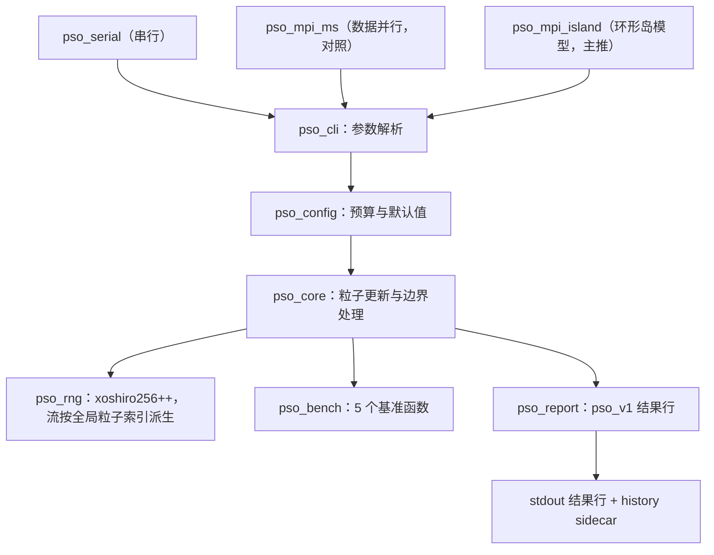

# PSO：C11 粒子群优化与 MPI 并行实现

本项目是一个使用 **C11** 编写的粒子群优化（PSO）实现：串行、MPI 全局数据并行与环形岛模型三个入口。MPI 提供进程间并行，OpenMP 提供可选的进程内并行。

[](https://github.com/Circumsized/PSO/actions/workflows/ci.yml)

程序最小化内置基准函数，支持串行、MPI 全局数据并行和 MPI 环形岛模型。三个入口共享粒子更新、参数解析、评估预算和结果格式。Python 脚本用于实验调度与结果分析。运行求解器不需要 Python 或 MATLAB。

## 1. 选择执行方式

| 可执行文件 | 执行方式 | 适用任务 |
|---|---|---|
| `pso_serial` | 单进程；可使用 OpenMP | 建立基线、检查参数、调试算法。 |
| `pso_mpi_ms` | MPI 全局数据并行；各 rank 使用全局最优位置 | 比较同一算法在不同进程数下的执行时间。 |
| `pso_mpi_island` | MPI 单向环岛模型；各 rank 使用本岛最优位置 | 研究分岛、周期迁移及时间与解质量的关系。 |

`pso_mpi_ms` 是可执行文件名；其结果中的实现名是 `mpi-data-parallel`。当前实现使用全局归约与广播。

> **说明：**岛模型改变了社会最优位置和随机流命名空间。改变岛数会改变算法配置。不要要求岛模型与串行入口产生相同轨迹。

### 架构总览

三个入口共享同一套核心模块：参数解析、预算换算、粒子更新、随机流、基准函数与结果输出完全一致，差异只在并行组织方式。



架构约束的完整定义见 [02-优化设计方案.md](docs/02-优化设计方案.md)（维护者向）。

## 2. 环境要求

| 组件 | 要求 | 用途 |
|---|---|---|
| C 编译器 | 支持 C11；本项目主要使用 GCC 验证 | 编译求解器与 C 测试。 |
| CMake | 3.20 或更高版本 | 配置、构建和注册测试。 |
| MPI | Linux 使用 OpenMPI 等 C MPI 实现；Windows 使用 MS-MPI Runtime 与 SDK | 构建和运行 MPI 入口。 |
| OpenMP | 编译器提供的 OpenMP 支持；可关闭 | 并行更新本地粒子。 |
| Python | 3.10 或更高版本；CI 使用 3.12 | 执行实验脚本与 Python 测试。 |
| matplotlib | 可选 | 使用 `plot_results.py --plot` 生成图像。 |

以下命令从仓库根目录执行。Windows 示例使用 **Git Bash**。不要把 `export` 和反斜杠续行直接复制到 PowerShell。

## 3. 构建并验证

### Windows：MinGW 与 MS-MPI

1. 将 CMake、MinGW 和 MS-MPI 启动器加入 `PATH`。
2. 安装与编译目标位数一致的 MS-MPI SDK。本项目的 fallback 使用 x64 库。
3. 执行以下命令。

```bash
cmake -S . -B build -G "MinGW Makefiles" -DCMAKE_BUILD_TYPE=Release -DPSO_ENABLE_MPI=ON -DPSO_ENABLE_OPENMP=ON
cmake --build build --parallel
ctest --test-dir build --output-on-failure -C Release
```

### Linux：GCC 与 MPI

安装 CMake、C 编译器和 MPI 开发环境后，执行以下命令。

```bash
cmake -S . -B build -DCMAKE_BUILD_TYPE=Release -DPSO_ENABLE_MPI=ON -DPSO_ENABLE_OPENMP=ON
cmake --build build --parallel
ctest --test-dir build --output-on-failure
```

### 仅构建单进程版本

在当前平台的已配置编译环境中执行以下命令。Windows MinGW 首次配置时添加 `-G "MinGW Makefiles"`。

```bash
cmake -S . -B build-serial -DCMAKE_BUILD_TYPE=Release -DPSO_ENABLE_MPI=OFF -DPSO_ENABLE_OPENMP=OFF
cmake --build build-serial --parallel
```

> **注意：**`PSO_ENABLE_MPI=ON` 表示请求启用 MPI。找不到 MPI 时，CMake 会警告并跳过 MPI 目标。必须检查配置输出中的 `PSO_ENABLE_MPI=ON`，并确认 MPI 可执行文件存在。`ctest` 成功不代表被跳过的组件已通过验证。

详细构建选项和故障处理见 [命令行与结果接口参考](docs/06-PSO命令行与结果接口参考.md)。

## 4. 运行第一个示例

先限制线程数。单进程入口在启用 OpenMP 时也会创建线程。

```bash
export OMP_NUM_THREADS=1
export OMP_DYNAMIC=FALSE
```

运行一个固定预算的 Sphere 示例：

```bash
./build/pso_serial --function sphere --particles 10 --dim 2 --max-evals 40 --target 0 --seed 7 --no-early-stop
```

正常执行时，标准输出包含一行以 `record=result schema=pso_v1` 开头的记录。检查以下字段：

| 字段 | 本例预期 | 解释 |
|---|---|---|
| `implementation` | `serial` | 单进程入口。 |
| `iterations` | `3` | 初始化之后执行三代更新。 |
| `evals` | `40` | 初始化 10 次，加上三代各 10 次。 |
| `success` | `0` | 本例未达到 `target=0`。 |
| `stop_reason` | `evaluation_budget` | 在预算允许的最后一代结束。 |
| `timing_scope` | `solver` | 计时不含初始种群评估。 |

`success=0` 表示未达到数值目标，不表示程序执行失败。`elapsed_max_s` 随机器负载变化；不要将其作为固定期望值。

### 运行 MPI 对照

```bash
mpiexec -n 4 ./build/pso_mpi_ms --function sphere --particles 10 --dim 2 --max-evals 40 --target 0 --seed 7 --no-early-stop
mpiexec -n 4 ./build/pso_mpi_island --function sphere --particles 10 --dim 2 --max-evals 40 --target 0 --seed 7 --no-early-stop --migration-interval 1
```

两个 MPI 示例都应报告 `ranks=4`、`iterations=3` 和 `evals=40`。只有 rank 0 输出最终结果行。Windows 可显式使用 `.exe` 后缀。

## 5. 使用参数和结果

执行以下命令查看参数帮助：

```bash
./build/pso_serial --help
```

| 任务 | 参数 |
|---|---|
| 选择基准函数 | `--function sphere`；另支持 `rosenbrock`、`rastrigin`、`griewank`、`ackley`。 |
| 指定问题规模 | `--particles N --dim D`；MPI 中 `N` 是所有 rank 的总粒子数。 |
| 固定评估预算 | `--max-evals B --no-early-stop`。 |
| 改用迭代上限 | `--max-evals 0 --max-iters K`。 |
| 比较边界策略 | `--boundary reflect`、`clamp` 或 `reinit`。 |
| 切换动力学 | `--linear-inertia`；默认使用收缩因子形式。 |
| 输出收敛轨迹 | `--history PATH`。 |
| 设置进程亲和性 | `--pin-cpus`；先确认平台支持及 CPU 数量足够。 |

> **注意：**求解器以截断方式写入 `--history PATH`。使用新路径保存轨迹。不要使用已归档证据文件的路径。

完整参数、预算取整规则、结果字段和诊断信息见 [接口参考](docs/06-PSO命令行与结果接口参考.md)。

## 6. 改进方法

| 改进对象 | 当前方法 | 作用 |
|---|---|---|
| MPI 通信 | 一致的集合通信顺序、`MPI_MINLOC` 和完整位置传输 | 避免 root-only collective 和跨进程索引错误。 |
| 随机状态 | xoshiro256++、splitmix64 和粒子级状态 | 使随机采样不依赖 OpenMP 任务分配。 |
| 粒子内存 | 连续动态数组；MPI rank 只保存本地分块 | 降低每个进程的粒子状态内存。 |
| 动力学与边界 | 收缩因子、线性惯性对照、三种边界模式 | 提供可重复的算法消融配置。 |
| 岛间迁移 | 单向环、周期交换、严格择优替换最差 pbest | 控制位置通信频率并同步移民状态。 |
| 实验口径 | 统一预算、结果协议、seed 配对和 manifest | 将执行时间、解质量和采集来源关联。 |

方法、公式和理论限制见 [算法与优化理论](docs/05-PSO算法与优化理论.md)。参考文献说明这些方法的来源，不代替本项目的测量证据。

## 7. 实验与证据

正式实验使用 `scripts/run_experiments.py`。默认只生成计划；添加 `--execute` 才运行求解器。

以下命令在构建目录中生成新计划，不覆盖正式证据：

```bash
python scripts/run_experiments.py --mode baseline --functions sphere,rastrigin --particles 2000 --dim 50 --max-evals 100000 --threads 1 --runs 30 --pin --history --output-dir build/doc-experiment-plan
```

正式采集时使用新的输出目录，审核参数、资源分配和生成的命令，再添加 `--execute`。runner 的 `--pin` 会生成求解器参数 `--pin-cpus`。不要同时指定 `--append` 和 `--history`。

历史主计时数据位于 `results/formal-20260912-v5-pinned/`。未绑核对照、Linux 子集、测量条件与数值表见 [基准测试报告](docs/03-基准测试报告.md)。本文不复写性能表，以免形成多份数值来源。

测试通过只能说明已执行用例满足断言。它不证明算法没有缺陷，也不证明并行入口在所有规模下都更快。Linux 的历史验证记录与当前代码的复验状态分别列于基准报告。

## 8. 文档导航

文档分两层：**用户文档**与**贡献者文档**。用户文档按 Diátaxis 四类组织——
**教程**（第一次怎么用）、**操作指南**（要办成某件事怎么做）、**参考**
（完整定义是什么）、**解读**（为什么是这样）；贡献者文档面向维护者。
第一次使用请从 [快速开始](docs/01-快速开始.md) 进入。

### 用户文档

| 文档 | 类型 | 说明 |
|---|---|---|
| [快速开始](docs/01-快速开始.md) | 教程 | 构建、运行第一个优化、读懂输出、跑两个 MPI 入口 |
| [操作指南](docs/04-操作指南.md) | 操作指南 | 入口选型、参数选择、常见任务、故障诊断与术语表 |
| [命令行与结果接口参考](docs/06-PSO命令行与结果接口参考.md) | 参考 | 每个参数与结果字段的完整定义（单一真相） |
| [算法与优化理论](docs/05-PSO算法与优化理论.md) | 解读 | 更新公式、参数依据、迁移机制与复杂度分析 |
| [基准测试报告](docs/03-基准测试报告.md) | 解读 | 采集协议、实测数字与结论边界 |

### 贡献者文档

| 文档 | 说明 |
|---|---|
| [优化设计方案](docs/02-优化设计方案.md) | 模块分工、执行流程与架构约束 |
| [参考文献与文档写作约定](docs/07-参考文献与文档写作约定.md) | 方法来源登记与文档维护规则 |
| [变更记录](CHANGELOG.md) | 各轮工程变更及其验证范围 |

## 9. 源码与许可证

- `include/`、`src/`：C11 求解器、公共头文件和三个入口。
- `tests/`：C 单元测试与 MPI 工作流测试。
- `scripts/`：Python 实验和分析工具；`scripts/tests/` 为其测试。
- `results/formal-*/`：归档测量证据。不要覆盖或删除。

本项目代码和工具使用 [MIT 许可证](LICENSE)。
