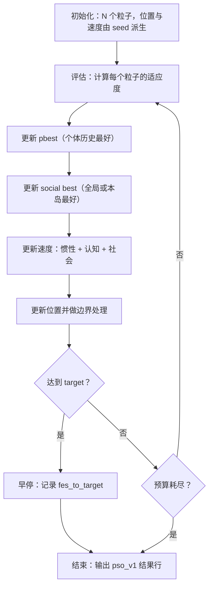

# PSO 快速开始

## 文档信息

| 项目 | 内容 |
|---|---|
| 文档编号 | DOC-01 |
| 文档名称 | PSO 快速开始 |
| 文档类型 | 上手拆解：把系统拆解为构成、参数、结果行、加速机制与设计原理，逐项分析，供快速掌握全貌与就地查阅 |
| 适用对象 | 第一次使用本项目的学习者与使用者；不需要优化算法背景——零基础读者先读 §0 预备概念 |
| 前置要求 | 会使用命令行；构建需要 CMake（≥3.20）与 C11 编译器，组件清单与安装要求见 [README「环境要求」](../README.md#2-环境要求) |
| 示例环境 | Windows + Git Bash + MinGW GCC + MS-MPI；Linux 见 [Dockerfile.linux](../Dockerfile.linux) 与 [03-基准测试报告.md](03-基准测试报告.md) |
| 接口契约 | `pso_v1` 结果行（完整字段定义见 [06-PSO命令行与结果接口参考.md](06-PSO命令行与结果接口参考.md)） |

分工约定：本文负责**拆解与理解**（构成、机制、术语、加速、原理）；[04-操作指南.md](04-操作指南.md)
负责**操作决策**（入口选择、参数调整、常见任务、故障处置）；[06-PSO命令行与结果接口参考.md](06-PSO命令行与结果接口参考.md)
是**完整契约**（语法、取值范围、全部字段）。三者冲突时以 06 与测试契约为准。

本文命令从仓库根目录执行，且为 **Git Bash 风格**（`/c/...` 盘符路径、`/tmp`、
`cat` 都是 MSYS 约定）。PowerShell 用户需把 `mpiexec` 路径写成 Windows 形式
并以 `&` 调用。文中输出均为真实运行结果（开发机单次运行），仅用于说明格式与
量级；可引用的性能数字只存在于 `docs/03` 声明的采集协议下。

## 0. 预备概念

零基础读者先读本节；已熟悉命令行与构建的可跳到 §1。

**优化问题**：在一片允许的取值范围（**搜索空间**，即每个变量的上下限）里找一组
具体数值（一个**候选解**），让目标函数的输出尽量小。目标函数在候选解上的输出
称**适应度**（fitness）——本项目里适应度越小越好。

**PSO**：粒子群优化（Particle Swarm Optimization，标题缩写）。维护一群候选解
（**粒子**）在搜索空间里飞行搜索：每个粒子记住自己的历史最好位置（pbest），
群体共享当前最好位置（social best），每步朝这两处修正飞行方向。

**本仓库**：上述算法的 C 实现（三个可执行程序）+ Python 实验工具链 + 自动化测试。

**工具链**（各一句，安装清单见 README「环境要求」）：CMake 读 `CMakeLists.txt`
生成构建步骤；MinGW GCC 是 Windows 上的 C 编译器；构建=把 C 代码翻译成可执行
文件；MS-MPI 提供多进程并行（每个进程有编号 rank）；OpenMP 提供单进程多线程
并行；Git Bash 是 Windows 上的 Linux 风格终端（本文命令的语法）。

**上手前自检**：打开 Git Bash，`cd` 到仓库根目录（或在仓库文件夹右键
「Open Git Bash Here」），然后各敲一行——能打印版本号即就绪，报
`command not found` 就是没装：

```bash
cmake --version   # CMake
gcc --version     # C 编译器（MinGW）
ls "/c/Program Files/Microsoft MPI/Bin/mpiexec.exe"   # MS-MPI（默认安装路径）
```

**命令记号速查**（详读见 §8.1 与 [06]）：`./` = 当前目录；行尾 `\`
= 续行；`#` 注释与 `...` 省略号都**不用敲**；`&&` = 左边成功才执行右边；引号
包住含空格的路径；`.exe` 在 Git Bash 下可省略；`cat 文件` = 打印文件内容；
`/tmp` = Git Bash 临时目录；`1e-08` = 0.00000001；`§` = 本文第几节；`χ` =
希腊字母 chi（收缩系数名）。

## 1. 系统构成与项目架构

### 1.1 三层构成

| 层 | 组成 | 本文对应章节 |
|---|---|---|
| 入口层 | 3 个可执行文件：`pso_serial`（串行）、`pso_mpi_ms`（数据并行）、`pso_mpi_island`（环形岛模型） | §2、§6 |
| 求解层 | 参数解析 → 预算换算 → 粒子初始化 → 迭代（评估/pbest/social best/速度/位置/停止） | §4、§7 |
| 输出层 | 一行 `pso_v1` 结果记录（stdout）+ 可选轨迹文件（`--history`） | §3、§8 |

### 1.2 模块架构

三个入口共享同一套求解模块，差异只在并行组织方式（§6 对比矩阵）：

| 模块（源文件） | 职责 |
|---|---|
| `pso_cli.c` | 命令行解析与值域校验 |
| `pso_config.h` | 全部默认值与预算→代数换算 |
| `pso_core.c` | 求解层核心：粒子初始化/速度/位置/边界/pbest/social best |
| `pso_rng.h` | xoshiro256++ 随机流，按全局粒子索引派生（可复现性的地基） |
| `pso_bench.c` | 5 个基准函数 |
| `pso_report.c` | `pso_v1` 结果行输出 |
| `pso_pin.c` | CPU 亲和性（绑核） |
| `main_serial.c` / `main_mpi_ms.c` / `main_mpi_island.c` | 三个入口：组织方式不同，共用上面全部模块 |
| `scripts/*.py` | 实验调度（run_experiments）、解析（plot_results）、统计（analyze_stats）、收敛汇总（summarize_convergence） |
| `tests/` + `scripts/tests/` | C 与 Python 自动化测试（48 + 188 项） |

模块间依赖与架构不变量的完整定义见
[02-优化设计方案.md](02-优化设计方案.md)（维护者向）。

## 2. 构建矩阵

| 开关组合 | 产物 | 说明 |
|---|---|---|
| `PSO_ENABLE_MPI=ON` + `PSO_ENABLE_OPENMP=ON`（默认均 ON） | 三个可执行文件 | MPI 找不到时自动降级为 OFF，构建不失败 |
| `PSO_ENABLE_MPI=OFF` | 仅 `pso_serial` | 无 MPI 环境（OpenMP 仍可用） |
| `PSO_ENABLE_OPENMP=OFF` | 三个可执行文件（串行更新） | `threads` 字段恒为 1 |

```bash
# Windows（MinGW + MS-MPI + OpenMP）
cmake -S . -B build -G "MinGW Makefiles" -DPSO_ENABLE_MPI=ON -DPSO_ENABLE_OPENMP=ON
cmake --build build --parallel

# Linux（同上但去掉 -G 一段）
cmake -S . -B build -DPSO_ENABLE_MPI=ON -DPSO_ENABLE_OPENMP=ON && cmake --build build --parallel
```

| 片段 | 含义 |
|---|---|
| `cmake -S . -B build` | `-S` 源码目录=当前目录；`-B` 产物放进新建的 `build/` 文件夹 |
| `-G "MinGW Makefiles"` | 选择 Windows/MinGW 构建方式（Linux 行没有这一段） |
| `-DPSO_ENABLE_MPI=ON` | `-D` 设置构建选项，`=ON` 即启用（语义见上表） |
| `cmake --build build --parallel` | 按配置真正开始构建；`--parallel` 多核编译 |

构建成功判据：无 `error` 字样，且 `ls build` 能看到三个可执行文件
（Windows 带 `.exe`）。全量构建通常一两分钟，滚动输出属正常。

## 3. 运行与结果行拆解

最小运行命令（串行入口）：

```bash
./build/pso_serial --function sphere --particles 16 --dim 2 --max-evals 6400 --seed 20240229
```

完整输出（真实运行，一整行，此处为阅读折行）：

```text
record=result schema=pso_v1 implementation=serial function=sphere particles=16 dim=2
max_evals=6400 max_iters=1000 seed=20240229 boundary=reflect dynamics=constriction
target=1e-08 lower=-100 upper=100 chi=0.72984 c1=1.49618 c2=1.49618 vmax_ratio=0.2
inertia_start=0.9 inertia_end=0.4 ranks=1 threads=20 migration_interval=0
iterations=82 evals=1328 best=1.8032187541123875e-09 success=1 fes_to_target=1328
stop_reason=target stop_on_target=1 timing_scope=solver elapsed_max_s=0.006166400
```

结果行 = **协议头**（`record=result schema=pso_v1`，解析器据此识别）+
**配置回显**（21 个字段，确认本次实际配置）+ **运行结果**（9 个字段，交付产出）。
命令里没敲的选项按内置默认值回显——所有选项都有默认值，只敲
`./build/pso_serial` 也能跑（默认 rastrigin、20000 粒子、50 维、100 万评估，
耗时较长）。Git Bash 下命令写 `pso_serial` 不带 `.exe` 也能跑（自动补全）。

### 3.1 配置回显字段（21 个）

| 字段 | 本例值 | 含义 |
|---|---|---|
| `implementation` | serial | 入口实现名（`serial`/`mpi-data-parallel`/`mpi-island`） |
| `function` | sphere | 基准函数（5 选 1，见 §10） |
| `particles` | 16 | 总粒子数；MPI 下为全进程总和，均分给各 rank |
| `dim` | 2 | 问题维度 |
| `max_evals` | 6400 | 评估预算上限；>0 时优先于 `max_iters` 生效 |
| `max_iters` | 1000 | 代数上限；仅 `max_evals=0` 时生效 |
| `seed` | 20240229 | 随机流基种子；全部随机性由此确定性派生 |
| `boundary` | reflect | 越界处理模式（reflect/clamp/reinit） |
| `dynamics` | constriction | 动力学模式（constriction/linear-inertia） |
| `target` | 1e-08 | 成功阈值；best ≤ target 记 success=1 并早停 |
| `lower` / `upper` | -100 / 100 | 搜索区间（随函数默认，可 `--lower/--upper` 覆盖） |
| `chi` | 0.72984 | 收缩因子，作用于惯性项（Clerc-Kennedy 设定） |
| `c1` / `c2` | 1.49618 / 1.49618 | 有效认知/社会系数（已含收缩效果） |
| `vmax_ratio` | 0.2 | 单代速度上限与区间宽度之比；无命令行开关，固定默认值 |
| `inertia_start` / `inertia_end` | 0.9 / 0.4 | 线性惯性起止权重；仅 `--linear-inertia` 时参与计算，回显始终存在 |
| `ranks` | 1 | MPI 进程数（串行为 1） |
| `threads` | 20 | OpenMP 线程数，取 `omp_get_max_threads()`，随机器核数变化；可用环境变量 `OMP_NUM_THREADS` 控制；未启用 OpenMP 时为 1 |
| `migration_interval` | 0 | 岛模型迁移周期（代）；非岛模型为 0 |

### 3.2 运行结果字段（9 个）

| 字段 | 本例值 | 含义 |
|---|---|---|
| `iterations` | 82 | 实际迭代代数（初始种群不算一代） |
| `evals` | 1328 | 实际评估总次数 = (iterations+1) × 每代粒子数 = 83 × 16 |
| `best` | 1.8032187541123875e-09 | 全局最好值 = 所有已访问位置中的最小适应度（适应度见 §0；不代表全局最优性证明） |
| `success` | 1 | best ≤ target 记 1，否则 0 |
| `fes_to_target` | 1328 | 首次达到 target 的整代评估数；未达标且预算 >0 时等于预算值（失败标记，非实际评估数） |
| `stop_reason` | target | 停止原因：`target`（达标早停）或 `evals`（预算耗尽） |
| `stop_on_target` | 1 | 早停开关回显（`--no-early-stop` 后为 0） |
| `timing_scope` | solver | 计时口径：不含种群初始化 |
| `elapsed_max_s` | 0.006166400 | 墙钟时间（秒）；MPI 下取各 rank 最大值 |

### 3.3 字段间关系（拆解要点）

- **`evals` 与 `iterations`**：评估轮数 = 初始种群 + 迭代代数 = iterations+1；
  每轮恰好消耗 particles 次评估，故 `evals = (iterations+1) × particles`。
- **`evals` 与 `fes_to_target`**：达标早停时两者相等（本例同为 1328）；加
  `--no-early-stop` 后 `evals` 涨到预算 6400，`fes_to_target` 仍记首次命中的
  1328——两个字段由此区分。
- **`success` / `stop_reason` / `fes_to_target`**：三者联动。success=1 时
  stop_reason=target、fes_to_target=首次命中值；success=0 时 stop_reason=evals、
  fes_to_target=预算值（失败标记）。
- **`max_evals` 与 `max_iters`**：前者 >0 时完全接管预算，后者仅在
  max_evals=0 时生效——两者不同时起作用。
- **可复现口径**：同一条命令重跑，结果行中除 `elapsed_max_s`（墙钟时间，必然
  随运行变化）外的所有字段逐位相同（随机流由 seed 确定性派生）。验证方法：
  重跑一次，把两次输出各存一个文件，肉眼或用 `diff 文件1 文件2` 对比——预期
  唯一差异就是最后的 `elapsed_max_s`。

## 4. 术语对照表

英文术语 ↔ 中文名 ↔ 本项目含义。算法机制、公式与参数依据见
[05-PSO算法与优化理论.md](05-PSO算法与优化理论.md)。

| 英文 | 中文 | 本项目含义 |
|---|---|---|
| Particle Swarm Optimization (PSO) | 粒子群优化 | 一群粒子协同搜索最小值的算法；本仓库的核心 |
| particle / position / velocity | 粒子 / 位置 / 速度 | 一个候选解 / 其坐标向量 / 每维一个的移动分量 |
| search space | 搜索空间 | 变量允许的取值范围（`lower`~`upper`） |
| fitness / objective | 适应度 / 目标函数值 | 目标函数在候选解上的输出；越小越好 |
| evaluation / FEs | 评估 / 函数评估次数 | 对一个位置求一次值；一代 = particles 次 |
| budget (`max-evals`) | 评估预算 | 统一的评估次数上限；跨配置比较的基准 |
| iteration / generation | 代 | 全部粒子各更新并评估一次 |
| pbest | 个体历史最好 | 粒子自己的历史最优位置及适应度 |
| social best | 社会最优位置 | 群体用于社会项的位置；串行与数据并行为全局，岛模型为本岛 |
| swarm | 粒子群 | 全体粒子；岛模型下每 rank 一个子群 |
| inertia weight (w) | 惯性权重 | 保持原方向的权重；`--linear-inertia` 时 0.9→0.4 |
| constriction factor (χ) | 收缩因子 | constriction 动力学中作用于惯性项的系数（0.72984） |
| c1 / c2 | 认知 / 社会系数 | 朝 pbest / 朝 social best 的加速系数（1.49618） |
| vmax_ratio | 速度上限比 | 单代速度上限与搜索区间宽度之比（0.2） |
| boundary handling | 边界处理 | 越界处置：reflect（反射）/ clamp（截断）/ reinit（重采样） |
| early stopping | 早停 | 达到 target 即停（`--no-early-stop` 关闭） |
| convergence | 收敛 | 搜索逐步改善、不再明显变好 |
| local / global minimum | 局部极小 / 全局最小 | 比邻居低但非全局最低 / 全域最低 |
| unimodal / multimodal | 单峰 / 多峰 | 只有一个山谷 / 散布大量局部极小 |
| seed | 种子 | 唯一随机源；每粒子的随机流按全局粒子索引从它派生 |
| bitwise reproducibility | 逐位可复现 | 同参数跨 rank 数与线程调度结果逐位一致（island 豁免） |
| rank | 进程编号 | MPI 进程编号，从 0 起 |
| data parallel (master-slave) | 数据并行 | 全局粒子均分给各 rank、每代同步（`pso_mpi_ms`） |
| island model | 岛模型 | 分岛并行演化 + 环形迁移（`pso_mpi_island`） |
| migration | 迁移 | 每 `migration_interval` 代沿环交换最优/最差粒子 |
| OpenMP | （不译） | 单进程多线程并行；`threads` = `omp_get_max_threads()` |
| pin / CPU affinity | 绑核 / 亲和性 | 把进程线程钉到固定 CPU 核（`--pin-cpus`） |
| sidecar | 轨迹文件 | `--history` 产出的逐代 best 文件 |
| manifest | 实验清单 | `run_experiments.py` 生成的 JSON 台账（命令、seed、日志路径） |
| dry-run | 试运行 | `run_experiments.py` 默认只生成计划不执行 |
| ERT | 期望运行评估数 | 达到 target 所需评估数的统计估计（收敛汇总输出） |
| Wilcoxon / Mann-Whitney U | 配对符号秩 / 秩和检验 | 本项目的两种统计检验（`analyze_stats.py`） |

## 5. 参数系统拆解

命令行共 22 个选项（含 `--help`），按职能拆为八组。取值范围与语法契约见
[06-PSO命令行与结果接口参考.md](06-PSO命令行与结果接口参考.md)；
调整建议（什么时候动哪个）见 [04-操作指南.md](04-操作指南.md) §2。

| 组 | 选项 | 作用 |
|---|---|---|
| 问题定义 | `--function` `--dim` `--particles` `--lower` `--upper` | 定义搜索什么、多大、在哪 |
| 预算与停止 | `--max-evals` `--max-iters` `--target` `--no-early-stop` | 定义跑多少、何时算成功、到点停不停 |
| 随机与复现 | `--seed` | 唯一随机源；换 seed 即换一次独立采样 |
| 动力学 | `--chi` `--c1` `--c2` `--linear-inertia` | 控制速度更新三部分的合成方式（constriction 与线性惯性二选一） |
| 边界 | `--boundary` | 粒子越界后的处置（reflect/clamp/reinit） |
| 输出 | `--history` `--verbose` `--quiet` `--report-interval` | 轨迹落盘与进度行 |
| MPI 与性能 | `--pin-cpus` `--migration-interval`；rank 数由 `mpiexec -n` | 绑核计时、岛模型迁移周期；没有 `--ranks` 选项 |
| 帮助 | `--help` | 用法文本 |

两个无开关的内置参数：`vmax_ratio=0.2`、`inertia_start=0.9`/`inertia_end=0.4`。
它们不出现在命令行，但固定参与求解并回显在结果行——改动需改源码默认值
（`include/pso_config.h`），属于维护者操作。

## 6. 入口机制与 PSO 加速原理

### 6.1 三入口对比

| 维度 | `pso_serial` | `pso_mpi_ms`（数据并行） | `pso_mpi_island`（环形岛） |
|---|---|---|---|
| 粒子组织 | 单进程持全部 | 全局粒子均分给各 rank | N 个岛各持一片，每 rank 一岛 |
| social best | 全局 | 全局（每代集合通信归约） | 本岛（每 `migration_interval` 代沿环迁移最优粒子） |
| 随机流命名空间 | 单一 | 单一（跨 rank 位级一致） | `0x100000000 + rank`（每岛独立） |
| 结果与串行的关系 | 基线 | **逐位相同**（与 rank 数无关） | **故意不同**（namespace 改变初始化与演化） |
| 定位 | 基线/调试 | 对照方案 | 主推方案 |

最小概念：`mpiexec -n N` 启动 N 个相同的求解进程，编号 0 到 N-1，每个进程称
为一个 rank。mpiexec 随 MS-MPI 默认安装在 `C:\Program Files\Microsoft MPI\Bin\`；
改过位置时替换命令引号内的路径。

### 6.2 本项目如何加速 PSO

PSO 单次求解的耗时几乎全部花在**函数评估**上（每代 particles 次）。本项目沿
三条轴加速，外加一个计时配套：

| 加速轴 | 机制 | 为什么有效 | 代价 |
|---|---|---|---|
| ① 评估分摊（数据并行） | 全局粒子均分给 N 个 rank 各自评估，每代结束用集合通信归约出全局 social best 并统一停止判断 | 各 rank 的评估互相独立，可完全并行；计算与串行逐位一致（不变量 ①），加速只来自评估时间分摊 | 每代一次同步：rank 越多、通信占比越高 |
| ② 并行探索（岛模型） | 把一整群分成 N 个小岛独立演化，每 `migration_interval` 代沿环迁移最优粒子交换信息 | N 份探索同时进行；迁移带来多样性，缓解单群早熟收敛 | 结果随 rank 数变化（namespace 豁免）；迁移本身有通信与替换代价 |
| ③ 线程内并行（OpenMP） | rank 内部按粒子并行做更新与评估 | 多核机器上单 rank 也更快 | 线程数过饱和时收益递减 |
| 配套：绑核（`--pin-cpus`） | 把进程/线程钉到固定 CPU 核 | 消除调度漂移，让计时可比 | 无（不影响计算结果，仅调度） |

**局限**：毫秒级小任务上进程启动与每代同步开销占主导——§3 的小型示例里 MPI
并不更快；评估特别便宜时，数据并行的收益也有限。**可引用的加速比**必须按
[03-基准测试报告.md](03-基准测试报告.md) 协议采集（`--pin-cpus`、≥30 seed），
其强扩展表给出各函数/ranks 的实测速度比与置信区间。

真实示例（数据并行 2 rank，与 §3 串行同参数）：

```bash
"/c/Program Files/Microsoft MPI/Bin/mpiexec.exe" -n 2 ./build/pso_mpi_ms \
  --function sphere --particles 16 --dim 2 --max-evals 6400 --seed 20240229
```

```text
record=result schema=pso_v1 implementation=mpi-data-parallel function=sphere ... ranks=2 ...
iterations=82 evals=1328 best=1.8032187541123875e-09 success=1 fes_to_target=1328 ...
elapsed_max_s=0.010140500
```

注：`best`、`evals`、`iterations` 与 §3 的串行运行逐位相同——加速轴 ① 只分摊
评估，不改计算。环形岛示例（4 岛）：

```bash
"/c/Program Files/Microsoft MPI/Bin/mpiexec.exe" -n 4 ./build/pso_mpi_island \
  --function sphere --particles 32 --dim 2 --max-evals 12800 \
  --seed 20240229 --migration-interval 5
```

```text
record=result schema=pso_v1 implementation=mpi-island function=sphere ... ranks=4 ...
iterations=46 evals=1504 best=1.0515495621938213e-10 success=1 ...
elapsed_max_s=0.007708100
```

注：岛模型结果与串行**不同**（best=1.05e-10 vs 1.80e-09）——namespace 豁免是
设计而非缺陷（[02-优化设计方案.md](02-优化设计方案.md) §3.3）；比较岛模型
必须固定 rank 数。

## 7. 算法主循环拆解



各阶段与参数、结果字段的对应关系：

| 阶段 | 做什么 | 挂钩的参数/字段 |
|---|---|---|
| 初始化 | 由 seed 派生每粒子随机流，区间内均匀撒点 | `seed`、`particles`、`lower/upper` |
| 评估 | 每粒子求值一次，累计进 `evals` | `function`、`evals` |
| pbest 更新 | 适应度优于个体历史则替换（最小化问题：更小为优） | （内部状态，不出现在结果行） |
| social best 更新 | 全局（serial/ms）或本岛（island） | `implementation`、`migration_interval` |
| 速度更新 | χ·惯性 + c1·认知 + c2·社会，限速到 `vmax_ratio`×宽度 | `chi`、`c1`、`c2`、`vmax_ratio`、`dynamics` |
| 位置更新与边界 | 越界按 `boundary` 处置 | `boundary`、`lower/upper` |
| 停止判定 | 达 target 早停或预算耗尽 | `target`、`max_evals`、`stop_reason`、`fes_to_target` |

**为什么按评估次数而不是迭代数计量**：`particles=16` 跑 82 代与
`particles=20000` 跑 1 代消耗同样的评估次数，但前者搜索得更充分。统一按评估
次数度量，不同 particles 的配置之间才可比。

## 8. 轨迹文件与计时口径

### 8.1 轨迹文件（`--history`）

```bash
./build/pso_serial --function sphere --particles 16 --dim 2 --max-evals 6400 \
  --seed 20240229 --history /tmp/demo.history
cat /tmp/demo.history
```

```text
iteration=0 evals=16 best=1071.800469473302
iteration=1 evals=32 best=192.81427435778758
iteration=2 evals=48 best=2.5286737577767631
```

每行三个字段：`iteration`（代号，0 为初始种群）、`evals`（截止该代的累计评估
数，= (iteration+1) × particles）、`best`（截止该代的全局最好值，单调不增——
只会变小或持平）。**收敛**指搜索逐步改善、不再明显变好的状态；收敛曲线就是
best 随代数下降过程的图。全部 83 行（1 + iterations）绘出的收敛曲线（纵轴
对数：数值每缩小十倍，图上才走一格；开发机单次真实运行，仅说明格式）：


批量汇总与绘图的操作路径见 [04-操作指南.md](04-操作指南.md) §4.3。

### 8.2 计时口径

`elapsed_max_s` 有三个必须知道的性质：只计求解过程（`timing_scope=solver`，
不含种群初始化）；MPI 下取各 rank 的最大值（而非平均）；单次运行受调度影响
波动。因此它只用于量级判断——可引用的性能数字必须来自
[03-基准测试报告.md](03-基准测试报告.md) 的采集协议。

## 9. 设计原理（本项目为什么这样建）

四条架构不变量（完整约束见 [02-优化设计方案.md](02-优化设计方案.md)，此处是学习者版本）：

1. **可复现性**：全部随机性只来自 `--seed`；每个粒子的随机流按其**全局粒子
   索引**确定性派生。因此固定 `(函数, 维度, 粒子数, 预算, seed)` 时，串行与
   数据并行的结果跨 rank 数、跨线程调度**逐位一致**；岛模型按
   `0x100000000 + rank` 派生命名空间，**故意**不跨 rank 一致。这一设计使
   「改并行不改结果」可被测试证明——也意味着改动随机流派生会作废全部既有
   位级结果（维护红线）。
2. **三入口同核**：串行、数据并行、岛模型共用同一求解模块，任何求解行为的
   改动必须在三处同步落地；所有 MPI 集合调用必须经过 `mpi_check` 检查。
3. **输出契约双钉**：`pso_v1` 的字段集同时被 Python 解析器和 CTest 输出正则
   钉住——改字段必须两侧同步，否则测试即红。
4. **测量卫生**：计时不含初始化；正式数字必须 `--pin-cpus`、≥30 seed 走 03
   协议；实验工具默认 dry-run 防止误采集；写文件失败、重复 seed 等数据完整性
   问题一律硬失败而非静默降级。

这些原理不是抽象口号：§3.3 的可复现口径、§6 的逐位相同、§8 的计时口径，都是
它们在结果行里的直接体现。

## 10. 基准函数

| 名称 | 搜索范围 | 最优值 | 特点 |
|---|---|---|---|
| `sphere` | [-100, 100] | 0（原点） | 单峰，最简单，适合验证管线 |
| `rosenbrock` | [-100, 100] | 0（全 1） | 狭长山谷，考验沿谷前进 |
| `rastrigin` | [-5.12, 5.12] | 0 | 大量局部极小，考验全局搜索 |
| `griewank` | [-600, 600] | 0 | 多峰 + 乘积项，大范围 |
| `ackley` | [-32.768, 32.768] | 0 | 多峰 + 指数外框 |

性质词直白解释：**单峰**——曲面只有一个山谷，走到谷底就是全局最优；**多峰**——
散布很多坑；**局部极小**——比邻居低但非全局最低的坑。多峰函数难在算法可能停在
局部极小里出不来，rastrigin 的大面积局部极小专门考验跳出能力（即术语「全局
搜索」）。默认函数为 `rastrigin`。五个函数都是轴对齐、未平移的经典函数，适合
学习与回归测试；性能结论的可推广性以
[03-基准测试报告.md](03-基准测试报告.md) 的限定表述为准（社区基准套件如
CEC-2013 的出处见 [07-参考文献与文档写作约定.md](07-参考文献与文档写作约定.md)
[R13]）。公式与逐函数性质分析见
[05-PSO算法与优化理论.md](05-PSO算法与优化理论.md)。

## 11. 下一步

- 选入口、调参数、完成具体任务、排除故障：[04-操作指南.md](04-操作指南.md)（操作指南）。
- 某个参数或输出字段的完整定义：[06-PSO命令行与结果接口参考.md](06-PSO命令行与结果接口参考.md)（参考）。
- 公式与参数依据：[05-PSO算法与优化理论.md](05-PSO算法与优化理论.md)（解读）。
- 实测数字与采集协议：[03-基准测试报告.md](03-基准测试报告.md)（解读）。
- 维护者向：[02-优化设计方案.md](02-优化设计方案.md)、
  [07-参考文献与文档写作约定.md](07-参考文献与文档写作约定.md)、
  [CHANGELOG.md](../CHANGELOG.md)。
