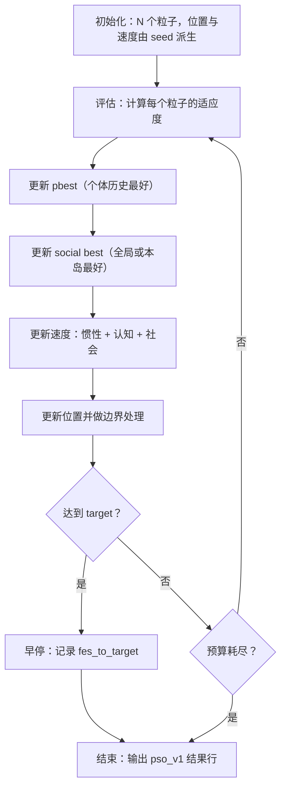
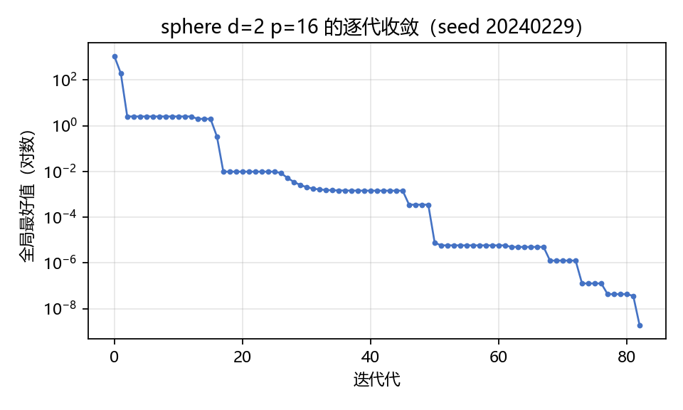

# PSO 快速开始

## 文档信息

| 项目 | 内容 |
|---|---|
| 文档编号 | DOC-01 |
| 文档名称 | PSO 快速开始 |
| 文档类型 | 上手拆解：把系统拆解为入口、参数、结果行、算法流程与计时口径，逐项分析，供快速掌握全貌与就地查阅 |
| 适用对象 | 第一次使用本项目的学习者与使用者；不需要优化算法背景——零基础读者**先读 §0 预备概念**。MPI 部分只用到 rank（MPI 进程编号）一个概念，见 §5 |
| 前置要求 | 会使用命令行；构建需要 CMake（≥3.20）与 C11 编译器，组件清单与安装要求见 [README「环境要求」](../README.md#2-环境要求) |
| 示例环境 | Windows + Git Bash + MinGW GCC + MS-MPI；Linux 见 [Dockerfile.linux](../Dockerfile.linux) 与 [03-基准测试报告.md](03-基准测试报告.md) |
| 接口契约 | `pso_v1` 结果行（完整字段定义见 [06-PSO命令行与结果接口参考.md](06-PSO命令行与结果接口参考.md)） |

分工约定：本文负责**拆解与理解**（构成、机制、字段含义）；[04-操作指南.md](04-操作指南.md)
负责**操作决策**（入口选择、参数调整、常见任务、故障处置）；[06-PSO命令行与结果接口参考.md](06-PSO命令行与结果接口参考.md)
是**完整契约**（语法、取值范围、全部字段）。三者冲突时以 06 与测试契约为准。

本文命令从仓库根目录执行，且为 **Git Bash 风格**（`/c/...` 盘符路径、`/tmp`、
`cat` 都是 MSYS 约定）。PowerShell 用户需把 `mpiexec` 路径写成 Windows 形式
并以 `&` 调用，例如
`& "C:\Program Files\Microsoft MPI\Bin\mpiexec.exe" -n 2 .\build\pso_mpi_ms.exe ...`。
文中输出均为真实运行结果（开发机单次运行），仅用于说明格式与量级；可引用的
性能数字只存在于 `docs/03` 声明的采集协议下。

## 0. 零基础预备

本节为零基础读者补齐三件事：这段技术是做什么的、命令怎么读、工具怎么确认。
已熟悉命令行与构建的读者可直接跳到 §1。

### 0.1 三个背景概念

- **优化问题**：在一片允许的取值范围（称为**搜索空间**，本项目里就是每个
  变量的上下限）里，寻找一组具体的数值（称为一个**候选解**），让某个目标
  函数的输出尽量小。目标函数在一个候选解上的输出称为**适应度**（fitness）——
  在本项目里适应度越小越好，最小的那个候选解就是我们要找的答案。
- **PSO**：粒子群优化（Particle Swarm Optimization，标题里的缩写就是它）。
  维护一群候选解（称为**粒子**），让它们像鸟群一样在搜索空间里飞行搜索：
  每个粒子记住自己到过的最好位置，群体共享当前最好位置，每一步都朝这两处
  修正飞行方向，直到预算用完或找到足够好的解。
- **本仓库**：上述算法的 C 语言实现（三个可执行程序），加上调度实验、
  解析结果、统计检验的 Python 工具，以及验证正确性的自动化测试。

### 0.2 工具链名词（各一句话）

| 名词 | 含义 |
|---|---|
| 命令行（终端） | 用打字的方式指挥电脑：输入一行命令、回车执行。Windows 上打开方式：开始菜单搜索「Git Bash」；或在仓库文件夹内右键 →「Open Git Bash Here」（这样就已经在仓库目录里） |
| 仓库 / 仓库根目录 | 这个项目的代码文件夹 / 其顶层目录（`CMakeLists.txt` 所在的那层）。本文所有命令都在根目录执行；不在的话先 `cd /d/PSO`（按你的实际路径改） |
| 构建与编译 | 把人写的 C 代码翻译成电脑能直接运行的程序文件（可执行文件）的过程 |
| CMake | 构建指挥工具：读 `CMakeLists.txt`，生成具体的构建步骤 |
| MinGW GCC | Windows 上的 C 编译器（做「翻译」这件事的程序），同时提供 make 类工具 |
| MS-MPI | 微软实现的 MPI。MPI 是「多进程并行」标准：同时启动多个相同的程序副本协同计算，每个副本有一个编号（rank，见 §5） |
| OpenMP | 单进程内多线程并行：一个程序内部用多个工人线程同时干活，适合单机多核 |
| Git Bash | Windows 上的 Linux 风格终端；本文命令按它的语法书写 |

工具自检（各敲一行，能打印版本号即就绪；报 `command not found` 就是没装，
去 [README「环境要求」](../README.md#2-环境要求) 按清单安装）：

```bash
cmake --version   # CMake
gcc --version     # C 编译器（MinGW）
ls "/c/Program Files/Microsoft MPI/Bin/mpiexec.exe"   # MS-MPI（默认安装路径）
```

### 0.3 命令怎么读（记号对照表）

| 记号 | 含义 |
|---|---|
| `./build/pso_serial` | `./` = 当前目录；即运行 build 文件夹里的 pso_serial 程序 |
| `--function sphere` | 双横线 = 选项名，后面跟它的取值 |
| 行尾 `\` | 续行符：下一行还是同一条命令（换行只为排版，粘成一整行等价） |
| `# 注释` | `#` 开头是说明文字，**不用敲** |
| `&&` | 仅当左边的命令成功后才执行右边 |
| 引号 `"..."` | 包住含空格的路径（如 `Program Files`），否则会被拆成两个词 |
| `...` | 文档的省略标记，表示「中间还有内容」，**不能敲** |
| `.exe` | Windows 可执行文件的后缀。Git Bash 下敲 `pso_serial` 会自动补上 `.exe`，所以带不带后缀都对 |
| `cat 文件` | 在屏幕上打印文件内容（只读，不改文件） |
| `/tmp` | Git Bash 的临时目录（Windows 实际位置约在 `C:\Users\你\AppData\Local\Temp`） |
| `1e-08` | 科学计数法：1×10⁻⁸ = 0.00000001；`1.8e-09` 即 0.0000000018… |
| `≥` `>` `≤` `×` | 不小于 / 大于 / 不大于 / 乘号 |
| `§` | 「本文第几节」，`§3` 即第 3 节 |
| `χ` | 希腊字母 chi，收缩系数的名字 |

Markdown 图（流程图）需要渲染环境；若你的查看器不渲染、看到的是一段英文
源码，按图的文字顺序对照相邻表格理解即可，内容一致。

## 1. 系统构成

一次 PSO 求解由三层构成，本文按此拆解：

| 层 | 组成 | 本文对应章节 |
|---|---|---|
| 入口层 | 3 个可执行文件：`pso_serial`（串行）、`pso_mpi_ms`（数据并行）、`pso_mpi_island`（环形岛模型） | §2、§5 |
| 求解层 | 参数解析 → 预算换算 → 粒子初始化 → 迭代（评估/pbest/social best/速度/位置/停止） | §4、§6 |
| 输出层 | 一行 `pso_v1` 结果记录（stdout）+ 可选轨迹文件（`--history`） | §3、§7 |

三个入口共享同一套求解层：粒子更新、参数、预算核算、停止判据、结果格式完全
一致，差异只在并行组织方式（§5 对比矩阵）。

## 2. 构建矩阵

| 开关组合 | 产物 | 说明 |
|---|---|---|
| `PSO_ENABLE_MPI=ON` + `PSO_ENABLE_OPENMP=ON`（推荐，默认均 ON） | 三个可执行文件 | MPI 找不到时自动降级为 OFF，构建不失败 |
| `PSO_ENABLE_MPI=OFF` | 仅 `pso_serial` | 无 MPI 环境（OpenMP 仍可用） |
| `PSO_ENABLE_OPENMP=OFF` | 三个可执行文件（串行更新） | `threads` 字段恒为 1 |

```bash
# Windows（MinGW + MS-MPI + OpenMP）
cmake -S . -B build -G "MinGW Makefiles" -DPSO_ENABLE_MPI=ON -DPSO_ENABLE_OPENMP=ON
cmake --build build --parallel

# Linux（不需要 -G 一行）
cmake -S . -B build -DPSO_ENABLE_MPI=ON -DPSO_ENABLE_OPENMP=ON && cmake --build build --parallel
```

命令逐段拆解（以 Windows 行为例）：

| 片段 | 含义 |
|---|---|
| `cmake` | 构建指挥工具（§0.2） |
| `-S .` | 源码目录 = 当前目录（即仓库根目录） |
| `-B build` | 构建产物放进**新建**的 `build/` 文件夹（名字是约定，可改） |
| `-G "MinGW Makefiles"` | 选择 Windows/MinGW 的构建方式（Linux 行没有这一段） |
| `-DPSO_ENABLE_MPI=ON` | `-D` = 设置一个构建选项，`=ON` 即启用；两个开关的语义见上表 |
| `cmake --build build --parallel` | 第二条命令：按上面的配置真正开始构建；`--parallel` = 多核并行编译 |

构建成功的判据：两条命令都没有 `error` 字样，且 `ls build` 能看到
`pso_serial`（开 MPI 时另有 `pso_mpi_ms`、`pso_mpi_island`）。全量构建通常
一两分钟内完成，期间大量滚动输出属正常。

可执行文件（Windows 带 `.exe`）：

| 可执行文件 | 入口 | 结果中的实现名 |
|---|---|---|
| `pso_serial` | 串行 | `serial` |
| `pso_mpi_ms` | MPI 数据并行 | `mpi-data-parallel` |
| `pso_mpi_island` | MPI 环形岛模型 | `mpi-island` |

## 3. 运行与结果行拆解

最小运行命令（串行入口）：

```bash
./build/pso_serial --function sphere --particles 16 --dim 2 --max-evals 6400 --seed 20240229
```

两处新手疑问先答：其一，§2 说 Windows 产物带 `.exe`，这里的命令却写
`./build/pso_serial`——Git Bash 会自动补全 `.exe`（§0.3），两种写法都对。
其二，输出行里 `max_iters=1000`、`boundary=reflect`、`dynamics=constriction`
等命令里没有敲的字段，显示的是**内置默认值**——所有选项都有默认值，理论上
只敲 `./build/pso_serial` 也能跑（默认 rastrigin、20000 粒子、50 维、100 万
评估，耗时较长）；第一次建议用本节的完整命令。

完整输出（真实运行，一整行，此处为阅读折行）：

```text
record=result schema=pso_v1 implementation=serial function=sphere particles=16 dim=2
max_evals=6400 max_iters=1000 seed=20240229 boundary=reflect dynamics=constriction
target=1e-08 lower=-100 upper=100 chi=0.72984 c1=1.49618 c2=1.49618 vmax_ratio=0.2
inertia_start=0.9 inertia_end=0.4 ranks=1 threads=20 migration_interval=0
iterations=82 evals=1328 best=1.8032187541123875e-09 success=1 fes_to_target=1328
stop_reason=target stop_on_target=1 timing_scope=solver elapsed_max_s=0.006166400
```

### 3.1 结果行结构

`pso_v1` 一行由三段组成：**协议头**（`record=result schema=pso_v1`，解析器以此
识别记录）+ **配置回显**（21 个字段，逐项确认本次运行的实际配置）+ **运行结果**
（9 个字段，交付本次求解的产出）。配置回显的意义：结果行自身就是完整的复现
凭据，不需要另记命令。

### 3.2 配置回显字段（21 个）

| 字段 | 本例值 | 含义 |
|---|---|---|
| `implementation` | serial | 入口实现名（`serial`/`mpi-data-parallel`/`mpi-island`） |
| `function` | sphere | 基准函数（5 选 1，见 §8） |
| `particles` | 16 | 总粒子数；MPI 下为全进程总和，均分给各 rank |
| `dim` | 2 | 问题维度 |
| `max_evals` | 6400 | 评估预算上限；>0 时优先于 `max_iters` 生效 |
| `max_iters` | 1000 | 代数上限；仅 `max_evals=0` 时生效 |
| `seed` | 20240229 | 随机流基种子；全部随机性由此确定性派生 |
| `boundary` | reflect | 越界处理模式（reflect/clamp/reinit） |
| `dynamics` | constriction | 动力学模式（constriction/linear-inertia） |
| `target` | 1e-08 | 成功阈值；best ≤ target 记 success=1 并早停 |
| `lower` / `upper` | -100 / 100 | 搜索区间（随函数默认，可 `--lower/--upper` 覆盖） |
| `chi` | 0.72984 | 收缩因子，作用于惯性项（Clerc-Kennedy 设定） |
| `c1` / `c2` | 1.49618 / 1.49618 | 有效认知/社会系数（已含收缩效果） |
| `vmax_ratio` | 0.2 | 单代速度上限与区间宽度之比；无命令行开关，固定默认值 |
| `inertia_start` / `inertia_end` | 0.9 / 0.4 | 线性惯性起止权重；仅 `--linear-inertia` 时参与计算，回显始终存在 |
| `ranks` | 1 | MPI 进程数（串行为 1） |
| `threads` | 20 | OpenMP 线程数，取 `omp_get_max_threads()`，随机器核数变化；可用环境变量 `OMP_NUM_THREADS` 控制；未启用 OpenMP 时为 1 |
| `migration_interval` | 0 | 岛模型迁移周期（代）；非岛模型为 0 |

注：`chi/c1/c2` 分别对应速度更新三部分——惯性、认知（飞向 pbest）、社会
（飞向 social best）——的系数（pbest/social best 的定义见 §0.1 与 §6）；
`vmax_ratio` 与 `inertia_start/end` 没有命令行开关，固定为内置默认值并如实
回显。

### 3.3 运行结果字段（9 个）

| 字段 | 本例值 | 含义 |
|---|---|---|
| `iterations` | 82 | 实际迭代代数（初始种群不算一代） |
| `evals` | 1328 | 实际评估总次数 = (iterations+1) × 每代粒子数 = 83 × 16 |
| `best` | 1.8032187541123875e-09 | 全局最好值 = 所有已访问位置中的最小适应度（适应度定义见 §0.1；它不代表全局最优性证明） |
| `success` | 1 | best ≤ target 记 1，否则 0 |
| `fes_to_target` | 1328 | 首次达到 target 的整代评估数；未达标且预算 >0 时等于预算值（失败标记，非实际评估数）；预算为 0 时记实际 evals |
| `stop_reason` | target | 停止原因：`target`（达标早停）或 `evals`（预算耗尽） |
| `stop_on_target` | 1 | 早停开关回显（`--no-early-stop` 后为 0） |
| `timing_scope` | solver | 计时口径：不含种群初始化 |
| `elapsed_max_s` | 0.006166400 | 墙钟时间（秒）；MPI 下取各 rank 最大值 |

### 3.4 字段间关系（拆解要点）

- **`evals` 与 `iterations`**：评估轮数 = 初始种群 + 迭代代数 = iterations+1；
  每轮恰好消耗 particles 次评估，故 `evals = (iterations+1) × particles`。
- **`evals` 与 `fes_to_target`**：达标早停时两者相等（本例同为 1328）；加
  `--no-early-stop` 后 `evals` 涨到预算 6400，`fes_to_target` 仍记首次命中的
  1328——两个字段由此区分。
- **`success` / `stop_reason` / `fes_to_target`**：三者联动。success=1 时
  stop_reason=target、fes_to_target=首次命中值；success=0 时 stop_reason=evals、
  fes_to_target=预算值（失败标记）。
- **`max_evals` 与 `max_iters`**：前者 >0 时完全接管预算，后者仅在
  max_evals=0 时生效——两者不同时起作用。
- **可复现口径**：同一条命令重跑，结果行中除 `elapsed_max_s`（墙钟时间，必然
  随运行变化）外的所有字段逐位相同（随机流由 seed 确定性派生）。验证方法：
  重跑一次，把两次输出各存一个文件，肉眼或用 `diff 文件1 文件2` 对比——预期
  唯一差异就是最后的 `elapsed_max_s`。

## 4. 参数系统拆解

命令行共 22 个选项（含 `--help`），按职能拆为八组。取值范围与语法契约见
[06-PSO命令行与结果接口参考.md](06-PSO命令行与结果接口参考.md)；
调整建议（什么时候动哪个）见 [04-操作指南.md](04-操作指南.md) §2。

| 组 | 选项 | 作用 |
|---|---|---|
| 问题定义 | `--function` `--dim` `--particles` `--lower` `--upper` | 定义搜索什么、多大、在哪 |
| 预算与停止 | `--max-evals` `--max-iters` `--target` `--no-early-stop` | 定义跑多少、何时算成功、到点停不停 |
| 随机与复现 | `--seed` | 唯一随机源；换 seed 即换一次独立采样 |
| 动力学 | `--chi` `--c1` `--c2` `--linear-inertia` | 控制速度更新三部分的合成方式（constriction 与线性惯性二选一） |
| 边界 | `--boundary` | 粒子越界后的处置（reflect/clamp/reinit） |
| 输出 | `--history` `--verbose` `--quiet` `--report-interval` | 轨迹落盘与进度行 |
| MPI 与性能 | `--pin-cpus` `--migration-interval`；rank 数由 `mpiexec -n` | 绑核计时、岛模型迁移周期；没有 `--ranks` 选项 |
| 帮助 | `--help` | 用法文本 |

两个无开关的内置参数：`vmax_ratio=0.2`、`inertia_start=0.9`/`inertia_end=0.4`。
它们不出现在命令行，但固定参与求解并回显在结果行——改动需改源码默认值
（`include/pso_config.h`），属于维护者操作。

## 5. 入口机制对比

三个入口的求解层完全一致，差异全在并行组织方式：

| 维度 | `pso_serial` | `pso_mpi_ms`（数据并行） | `pso_mpi_island`（环形岛） |
|---|---|---|---|
| 粒子组织 | 单进程持全部 | 全局粒子均分给各 rank | N 个岛各持一片，每 rank 一岛 |
| social best | 全局 | 全局（每代集合通信归约） | 本岛（每 `migration_interval` 代沿环迁移最优粒子） |
| 随机流命名空间 | 单一 | 单一（跨 rank 位级一致） | `0x100000000 + rank`（每岛独立） |
| 结果与串行的关系 | 基线 | **逐位相同**（与 rank 数无关） | **故意不同**（namespace 改变初始化与演化） |
| 定位 | 基线/调试 | 对照方案 | 主推方案 |

最小概念：`mpiexec -n N` 启动 N 个相同的求解进程，编号 0 到 N-1，每个进程称
为一个 rank。数据并行把全部粒子均分给各 rank；岛模型把粒子分成 N 个岛。

mpiexec 的完整路径随 MS-MPI 默认安装在 `C:\Program Files\Microsoft MPI\Bin\`；
改过安装位置时，把命令引号内的路径替换为你的实际位置（MSYS 下写作 `/c/...`
形式，见 §0.3）。

数据并行示例（2 rank）：

```bash
"/c/Program Files/Microsoft MPI/Bin/mpiexec.exe" -n 2 ./build/pso_mpi_ms \
  --function sphere --particles 16 --dim 2 --max-evals 6400 --seed 20240229
```

```text
record=result schema=pso_v1 implementation=mpi-data-parallel function=sphere ... ranks=2 ...
iterations=82 evals=1328 best=1.8032187541123875e-09 success=1 fes_to_target=1328 ...
elapsed_max_s=0.010140500
```

注：`best`、`evals`、`iterations` 与 §3 的串行运行逐位相同——数据并行只改变
速度，不改变计算结果。换 `-n 4` 再跑仍相同。

环形岛示例（4 岛，每岛 8 粒子，每 5 代迁移一次）：

```bash
"/c/Program Files/Microsoft MPI/Bin/mpiexec.exe" -n 4 ./build/pso_mpi_island \
  --function sphere --particles 32 --dim 2 --max-evals 12800 \
  --seed 20240229 --migration-interval 5
```

```text
record=result schema=pso_v1 implementation=mpi-island function=sphere ... ranks=4 ...
iterations=46 evals=1504 best=1.0515495621938213e-10 success=1 ...
elapsed_max_s=0.007708100
```

注：岛模型结果与串行**不同**（best=1.05e-10 vs 1.80e-09）——namespace 豁免是
设计而非缺陷（[02-优化设计方案.md](02-优化设计方案.md) §3.3）；比较岛模型
必须固定 rank 数。这两个 MPI 示例的绝对耗时（0.0077–0.0101 秒）不低于 §3 的
小型串行示例（0.0062 秒）：毫秒级任务里进程启动与同步开销占主导，并行加速
在大规模预算下才显现（两例配置不同，本就不该直接对比）；可引用的数字见
[03-基准测试报告.md](03-基准测试报告.md)。

## 6. 算法主循环拆解

粒子群优化在搜索空间中维护一组候选解（粒子）。每个粒子持有位置与速度，记住
自己的历史最好位置（pbest）；群体维护一个用于社会项的位置（social best，按
入口为全局或本岛）。速度更新由三部分合成：惯性（χ 加权的原方向）、认知
（c1 × 朝 pbest）、社会（c2 × 朝 social best）。



各阶段与参数、结果字段的对应关系：

| 阶段 | 做什么 | 挂钩的参数/字段 |
|---|---|---|
| 初始化 | 由 seed 派生每粒子随机流，区间内均匀撒点 | `seed`、`particles`、`lower/upper` |
| 评估 | 每粒子求值一次，累计进 `evals` | `function`、`evals` |
| pbest 更新 | 适应度优于个体历史则替换 | （内部状态，不出现在结果行） |
| social best 更新 | 全局（serial/ms）或本岛（island） | `implementation`、`migration_interval` |
| 速度更新 | χ·惯性 + c1·认知 + c2·社会，限速到 `vmax_ratio`×宽度 | `chi`、`c1`、`c2`、`vmax_ratio`、`dynamics` |
| 位置更新与边界 | 越界按 `boundary` 处置 | `boundary`、`lower/upper` |
| 停止判定 | 达 target 早停或预算耗尽 | `target`、`max_evals`、`stop_reason`、`fes_to_target` |

**为什么按评估次数而不是迭代数计量**：`particles=16` 跑 82 代与
`particles=20000` 跑 1 代消耗同样的评估次数，但前者搜索得更充分。统一按评估
次数度量，不同 particles 的配置之间才可比。完整术语表见
[04-操作指南.md](04-操作指南.md)。

## 7. 轨迹文件与计时口径

### 7.1 轨迹文件（`--history`）

```bash
./build/pso_serial --function sphere --particles 16 --dim 2 --max-evals 6400 \
  --seed 20240229 --history /tmp/demo.history
cat /tmp/demo.history
```

（记号 `cat`、`/tmp` 的含义见 §0.3 记号对照表。）

```text
iteration=0 evals=16 best=1071.800469473302
iteration=1 evals=32 best=192.81427435778758
iteration=2 evals=48 best=2.5286737577767631
```

每行三个字段：`iteration`（代号，0 为初始种群）、`evals`（截止该代的累计评估
数，= (iteration+1) × particles）、`best`（截止该代的全局最好值，单调不增——
只会变小或持平，不会回升）。**收敛**指搜索过程逐步改善、不再明显变好的状态；
收敛曲线就是 best 随代数下降过程的图。全部 83 行（1 + iterations）绘出的
收敛曲线（纵轴对数：数值每缩小十倍，图上才走一格——用于看清跨越多个数量级
的下降；开发机单次真实运行，仅说明格式，不是性能数据）：



批量汇总与绘图的操作路径见 [04-操作指南.md](04-操作指南.md) §4.3。

### 7.2 计时口径

`elapsed_max_s` 有三个必须知道的性质：只计求解过程（`timing_scope=solver`，
不含种群初始化）；MPI 下取各 rank 的最大值（而非平均）；单次运行受调度影响
波动。因此它只用于量级判断——可引用的性能数字必须来自
[03-基准测试报告.md](03-基准测试报告.md) 的采集协议（`--pin-cpus`、≥30 seed）。

## 8. 基准函数

| 名称 | 搜索范围 | 最优值 | 特点 |
|---|---|---|---|
| `sphere` | [-100, 100] | 0（原点） | 单峰，最简单，适合验证管线 |
| `rosenbrock` | [-100, 100] | 0（全 1） | 狭长山谷，考验沿谷前进 |
| `rastrigin` | [-5.12, 5.12] | 0 | 大量局部极小，考验全局搜索 |
| `griewank` | [-600, 600] | 0 | 多峰 + 乘积项，大范围 |
| `ackley` | [-32.768, 32.768] | 0 | 多峰 + 指数外框 |

性质词的直白解释：**单峰**——曲面只有一个「山谷」，走到谷底就是全局最优；
**多峰**——曲面上散布很多坑；**局部极小**——比周围邻居都低、但不是全局最低
的坑。多峰函数（rastrigin/griewank/ackley）难，就难在算法可能停在一个局部
极小里出不来；rastrigin 的大面积局部极小专门用来考验算法跳出这些坑的能力
（术语「全局搜索」即指这种跳出能力）。

默认函数为 `rastrigin`。五个函数都是轴对齐、未平移的经典函数，适合学习与
回归测试；性能结论的可推广性以 [03-基准测试报告.md](03-基准测试报告.md)
的限定表述为准（社区基准套件如 CEC-2013 的出处见
[07-参考文献与文档写作约定.md](07-参考文献与文档写作约定.md) [R13]）。
公式与逐函数性质分析见 [05-PSO算法与优化理论.md](05-PSO算法与优化理论.md)。

## 9. 下一步

- 选入口、调参数、完成具体任务、排除故障：[04-操作指南.md](04-操作指南.md)（操作指南）。
- 某个参数或输出字段的完整定义：[06-PSO命令行与结果接口参考.md](06-PSO命令行与结果接口参考.md)（参考）。
- 公式与参数依据：[05-PSO算法与优化理论.md](05-PSO算法与优化理论.md)（解读）。
- 实测数字与采集协议：[03-基准测试报告.md](03-基准测试报告.md)（解读）。
- 维护者向：[02-优化设计方案.md](02-优化设计方案.md)、
  [07-参考文献与文档写作约定.md](07-参考文献与文档写作约定.md)、
  [CHANGELOG.md](../CHANGELOG.md)。
