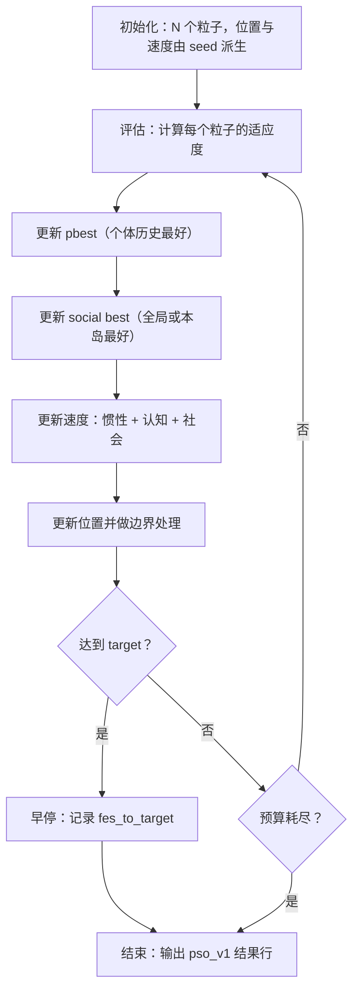

# PSO 快速开始

## 文档信息

| 项目 | 内容 |
|---|---|
| 文档编号 | DOC-01 |
| 文档名称 | PSO 快速开始 |
| 文档类型 | 教程（Tutorial）：面向第一次使用，以获得一次完整的上手体验为目标 |
| 适用对象 | 第一次使用本项目的学习者与使用者；不需要优化算法背景。第 4 节的 MPI 示例只用到 rank（MPI 进程编号）一个概念，文中已给最小解释 |
| 前置要求 | 会使用命令行；构建需要 CMake（≥3.20）与 C11 编译器，组件清单与安装要求见 [README「环境要求」](../README.md#2-环境要求) |
| 示例环境 | Windows + Git Bash + MinGW GCC + MS-MPI；Linux 见 [Dockerfile.linux](../Dockerfile.linux) 与 [03-基准测试报告.md](03-基准测试报告.md) |
| 接口契约 | `pso_v1` 结果行（完整字段定义见 [06-PSO命令行与结果接口参考.md](06-PSO命令行与结果接口参考.md)） |

本文中的命令与输出均为真实运行结果（开发机单次运行），仅用于说明格式与量级；
可引用的性能数字只存在于 `docs/03` 声明的采集协议下。命令从仓库根目录执行，
且为 **Git Bash 风格**（`/c/...` 盘符路径、`/tmp`、`cat` 都是 MSYS 约定）。
PowerShell 用户需把 `mpiexec` 路径写成 Windows 形式并以 `&` 调用，例如
`& "C:\Program Files\Microsoft MPI\Bin\mpiexec.exe" -n 2 .\build\pso_mpi_ms.exe ...`。

## 1. 构建

```bash
# Windows（MinGW + MS-MPI + OpenMP）
cmake -S . -B build -G "MinGW Makefiles" -DPSO_ENABLE_MPI=ON -DPSO_ENABLE_OPENMP=ON
cmake --build build --parallel

# Linux（不需要 -G 一行）
cmake -S . -B build -DPSO_ENABLE_MPI=ON -DPSO_ENABLE_OPENMP=ON && cmake --build build --parallel
```

构建完成后得到三个可执行文件（Windows 带 `.exe`）。机器上没有 MPI 时，把
`-DPSO_ENABLE_MPI=ON` 改为 `OFF` 即可——只构建 `pso_serial`；构建时找不到
MPI 也会自动降级为 OFF，不会失败。

| 可执行文件 | 入口 | 一句话 |
|---|---|---|
| `pso_serial` | 串行 | 单进程基线；编译启用 OpenMP 后可用线程并行更新 |
| `pso_mpi_ms` | MPI 数据并行 | 同一群粒子分块更新，结果与串行逐位一致 |
| `pso_mpi_island` | MPI 环形岛模型 | 多个岛独立演化、周期交换移民（本项目主推方案） |

## 2. 第一个优化

```bash
./build/pso_serial --function sphere --particles 16 --dim 2 --max-evals 6400 --seed 20240229
```

真实输出（一整行，此处为阅读折行）：

```text
record=result schema=pso_v1 implementation=serial function=sphere particles=16 dim=2
max_evals=6400 max_iters=1000 seed=20240229 boundary=reflect dynamics=constriction
target=1e-08 lower=-100 upper=100 chi=0.72984 c1=1.49618 c2=1.49618 vmax_ratio=0.2
inertia_start=0.9 inertia_end=0.4 ranks=1 threads=20 migration_interval=0
iterations=82 evals=1328 best=1.8032187541123875e-09 success=1 fes_to_target=1328
stop_reason=target stop_on_target=1 timing_scope=solver elapsed_max_s=0.006166400
```

这一行分两部分：

**回显你的配置**（输入参数的确认）：`implementation`、`function`、`particles`、
`dim`、`max_evals`、`max_iters`、`seed`、`boundary`、`dynamics`、`target`、
`lower`、`upper`、`chi`、`c1`、`c2`、`vmax_ratio`、`inertia_start`、
`inertia_end`、`ranks`、`threads`、`migration_interval`。其中两个与机器有关：
`ranks` 是 MPI 进程数（串行为 1）；`threads` 是 OpenMP 线程数（取
`omp_get_max_threads()`，随机器核数变化，可用环境变量 `OMP_NUM_THREADS`
控制）。`chi/c1/c2` 是速度更新三部分（惯性/认知/社会）的系数，含义见第 6 节。
全部字段的完整定义见
[06-PSO命令行与结果接口参考.md](06-PSO命令行与结果接口参考.md)。

**本次运行的结果**（第一次最该先看的七个字段）：

| 字段 | 本例值 | 含义 |
|---|---|---|
| `best` | 1.803e-09 | 找到的最优（最小）函数值 |
| `success` | 1 | 是否达到 `target`（1=达到，0=未达到） |
| `evals` | 1328 | 实际消耗的函数评估次数：初始种群 16 次 + 82 代 × 每代 16 次 |
| `iterations` | 82 | 实际演化的代数（初始种群不算一代，所以评估轮数 = iterations + 1） |
| `fes_to_target` | 1328 | 首次达到 target 时的评估次数；未达标时等于预算值（失败标记，非实际评估数） |
| `stop_reason` | target | 停止原因：`target`（达标早停）或 `evals`（预算耗尽） |
| `elapsed_max_s` | 0.0062 | 墙钟时间（秒）；不含种群初始化；MPI 下取各 rank 最大值 |

注意 `evals=1328 < max_evals=6400`：达到 target 后提前停止，预算没有用完。
想跑满预算做公平比较，加 `--no-early-stop`——此时 `evals` 会涨到 6400，
而 `fes_to_target` 仍记录首次命中的 1328，两个字段由此区分。

## 3. 看看收敛过程

```bash
./build/pso_serial --function sphere --particles 16 --dim 2 --max-evals 6400 \
  --seed 20240229 --history /tmp/demo.history
cat /tmp/demo.history
```

轨迹文件（sidecar）每代一行，记录截止到该代的全局最好值：

```text
iteration=0 evals=16 best=1071.800469473302
iteration=1 evals=32 best=192.81427435778758
iteration=2 evals=48 best=2.5286737577767631
```

`iteration=0` 是初始种群（所以共 83 行记录 = 初始种群 + 82 代迭代，正好对上
第 2 节的 `iterations=82`）。这条命令的完整轨迹绘出的收敛曲线
（纵轴对数；开发机单次真实运行，仅说明格式，不是性能数据）：


## 4. 用 MPI 跑

先补一个最小概念：`mpiexec -n N` 启动 N 个相同的求解进程，编号 0 到 N-1，
每个进程称为一个 rank。数据并行入口把全部粒子均分给各 rank；岛模型入口把
粒子分成 N 个岛，每 rank 一岛。

数据并行入口（2 个 rank）：

```bash
"/c/Program Files/Microsoft MPI/Bin/mpiexec.exe" -n 2 ./build/pso_mpi_ms \
  --function sphere --particles 16 --dim 2 --max-evals 6400 --seed 20240229
```

```text
record=result schema=pso_v1 implementation=mpi-data-parallel function=sphere ... ranks=2 ...
iterations=82 evals=1328 best=1.8032187541123875e-09 success=1 fes_to_target=1328 ...
elapsed_max_s=0.010140500
```

**关键观察**：`best`、`evals`、`iterations` 与第 2 节的串行运行**逐位相同**。
这是架构不变量 1——固定 `(函数, 维度, 粒子数, 预算, seed)` 时，数据并行只改变
速度，不改变计算结果，且与 rank 数无关。自己换 `-n 4` 再跑一次验证。

环形岛模型入口（4 个岛，每岛 8 粒子，每 5 代迁移一次）：

```bash
"/c/Program Files/Microsoft MPI/Bin/mpiexec.exe" -n 4 ./build/pso_mpi_island \
  --function sphere --particles 32 --dim 2 --max-evals 12800 \
  --seed 20240229 --migration-interval 5
```

```text
record=result schema=pso_v1 implementation=mpi-island function=sphere ... ranks=4 ...
iterations=46 evals=1504 best=1.0515495621938213e-10 success=1 ...
elapsed_max_s=0.007708100
```

**关键观察**：岛模型的结果与串行**不同**（best=1.05e-10 vs 1.80e-09）。这不是
bug，是设计豁免（[02-优化设计方案.md](02-优化设计方案.md) §3.3）：每个岛按
`0x100000000 + rank` 派生随机流命名空间，因此岛模型结果**故意**随 rank 数变化。
比较岛模型时必须固定 rank 数。

本例的计时还揭示一个常见现象：这两个 MPI 示例的绝对耗时（0.0077–0.0101 秒）
不低于第 2 节的小型串行示例（0.0062 秒）。毫秒级任务里进程启动与同步开销占
主导，并行加速在大规模预算下才显现（两例配置不同，本就不该直接对比）；可引用
的数字见 [03-基准测试报告.md](03-基准测试报告.md)。

## 5. 本次运行验证的关键性质

1. **可复现**：同一条命令重跑，结果行中除 `elapsed_max_s`（墙钟时间，必然
   随运行变化）外的所有字段逐位相同（随机流由 seed 确定性派生）。自己重跑
   一次，逐字段对比验证。
2. **rank 不变性**：serial 与 mpi-ms 任意 rank 数结果相同；island 按设计豁免。
3. **早停与预算**：`success=1`、`stop_reason=target`、`evals < max_evals`。

## 6. 基本概念

粒子群优化（Particle Swarm Optimization）模拟一群鸟觅食：每只鸟（粒子）在
搜索空间里有一个位置和一个速度；每只记住自己飞过的最好位置（pbest），群体
共享当前最好位置（social best）；下一步速度由三部分合成——惯性（保持原方向）、
认知（飞向自己的 pbest）、社会（飞向群体的 social best）。第 2 节输出里的
`chi=0.72984` 与 `c1=c2=1.49618` 就是这三部分的控制系数（标准收缩因子设定），
`vmax_ratio=0.2` 限制单代速度幅度；不动它们也能完成本教程。

主循环如下（更新公式见 [05-PSO算法与优化理论.md](05-PSO算法与优化理论.md)）：



**为什么用评估次数而不是迭代数做预算**：`particles=16` 跑 82 代与
`particles=20000` 跑 1 代都消耗 1328 次评估，但前者搜索得更充分。统一按评估
次数度量，配置之间才可比。完整术语表见
[04-操作指南.md](04-操作指南.md) 第 6 节。

## 7. 下一步

- 想选入口、调参数、完成具体任务或排除故障：阅读
  [04-操作指南.md](04-操作指南.md)（操作指南）。
- 想查某个参数或输出字段的完整定义：阅读
  [06-PSO命令行与结果接口参考.md](06-PSO命令行与结果接口参考.md)（参考）。
- 想理解公式与参数依据：阅读
  [05-PSO算法与优化理论.md](05-PSO算法与优化理论.md)（解读）。
- 想看实测数字与采集协议：阅读
  [03-基准测试报告.md](03-基准测试报告.md)（解读）。

## 8. 参见

- [README.md](../README.md)：项目总览与快速索引
- [04-操作指南.md](04-操作指南.md)
- [06-PSO命令行与结果接口参考.md](06-PSO命令行与结果接口参考.md)
- [05-PSO算法与优化理论.md](05-PSO算法与优化理论.md)
- [03-基准测试报告.md](03-基准测试报告.md)
