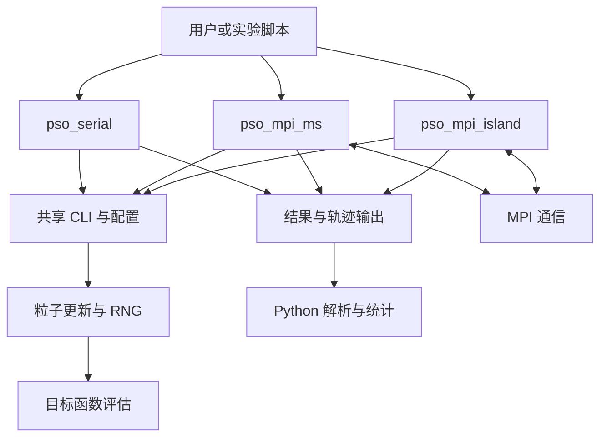

# PSO 优化设计方案

| 项目 | 内容 |
|---|---|
| 对象 | C11 串行、MPI 数据并行和 MPI 岛模型 |
| 用途 | 说明模块职责、运行流程、架构约束与验证方式 |
| 相关文档 | [算法与理论](05-PSO算法与优化理论.md)、[接口参考](06-PSO命令行与结果接口参考.md)、[基准报告](03-基准测试报告.md) |

## 1. 设计目标

本项目提供共享核心与独立执行入口的 C11 PSO 实现。设计目标如下。

| 目标 | 要求 | 验证方式 |
|---|---|---|
| 通信正确 | 同一通信域的 rank 按匹配顺序参加集合操作 | 多 rank 测试、错误检查和超时检查 |
| 预算一致 | 初始化计入评估数；不执行预算以外的部分代 | 预算换算与零代边界测试 |
| 结果可复现 | 粒子随机状态不依赖线程分配 | 固定 seed、线程对照与数值金标准 |
| 对照可解释 | 区分数据并行等价性与岛模型算法变化 | 分入口记录随机映射和社会邻域 |
| 内存可扩展 | 每个 MPI rank 只保存本地粒子状态 | 连续分区和动态分配 |
| 证据可追溯 | 运行参数、日志、轨迹与 seed 有对应关系 | manifest、解析器与配对校验 |

## 2. 模块与边界

图中箭头表示调用或数据依赖。MPI 调用由入口控制，公共粒子核心不调用 MPI。

| 模块 | 职责 | 不承担的职责 |
|---|---|---|
| [pso_core.c](../src/pso_core.c) | 粒子状态、初始化、更新、边界、pbest、移民注入 | MPI 通信与文件格式 |
| [pso_bench.c](../src/pso_bench.c) | 内置目标函数与默认区间 | 通用用户回调注册 |
| [pso_rng.h](../include/pso_rng.h) | xoshiro256++、splitmix64 与流播种 | 时间播种与密码学随机数 |
| [pso_config.c](../src/pso_config.c) | 默认配置与预算换算 | 实验矩阵生成 |
| [pso_cli.c](../src/pso_cli.c) | 公共命令行解析与帮助 | MPI 启动器参数 |
| [pso_pin.c](../src/pso_pin.c) | 拓扑枚举与进程 CPU 亲和性 | CPU 频率与电源策略设置 |
| [pso_report.c](../src/pso_report.c) | `pso_v1` 结果行与逐代轨迹 | 汇总统计与绘图 |
| 三个 `main_*.c` | 生命周期、计时、停止、资源管理；MPI 入口管理通信 | Python 分析 |
| [run_experiments.py](../scripts/run_experiments.py) | 矩阵、环境、manifest、子进程执行 | 粒子更新 |

### 2.1 数据布局

位置、速度和 pbest 位置采用连续行主序数组：`array[i * dim + j]`。适应度和 RNG 按本地粒子保存；最好位置另存一个维度向量。

串行保存 $N$ 个粒子。MPI rank 保存 $n_r$ 个粒子。主要内存随 $n_rD$ 增长。此布局避免每个 rank 都分配全量静态粒子数组。

### 2.2 源码类别

| 目录 | 定位 | 维护约束 |
|---|---|---|
| `src/`、`include/` | 重构实现 | 三个入口共享核心与协议 |
| `results/formal-*/` | 历史实测证据 | 不在质量修复中覆盖或重采 |

## 3. 执行流程与架构约束

### 3.1 公共流程

1. 初始化默认配置并解析参数。
2. 检查进程分配和可选亲和性。
3. 分配并初始化本地粒子。
4. 启动 solver 计时，确定初始最好值。
5. 检查目标阈值，并按允许代数循环。
6. 停止计时，关闭轨迹文件。
7. 输出结果并释放资源。

MPI 入口在本地初始化后、起表前执行 barrier。初始最优归约在计时内。只有 rank 0 写结果和全局轨迹。

### 3.2 串行与数据并行

数据并行使用连续分块。各 rank 的本地更新结束后，执行 `MPI_Allreduce(MPI_MINLOC)` 选择最好值及拥有者，再由拥有者广播完整位置。下一代所有 rank 使用该全局位置。

串行与数据并行都使用 namespace 0 和全局粒子索引。完整配置和数值环境相同、适应度有限时，这一映射支持跨 rank 数的等价比较。改变 OpenMP 线程数不重新播种粒子。

### 3.3 岛模型

各 rank 在本岛使用本地最好位置。每到迁移周期，向右邻居发送最好粒子，从左邻居接收粒子。只有严格优于本岛最差 pbest 的移民才被接受。

岛模型使用 `0x100000000 + rank` 作为 namespace，本地下标作为粒子索引。改变 rank 数既改变初始化，也改变分岛和迁移。不能对岛模型声明跨 rank 数结果不变，单 rank 岛模型也不等价于串行初始化。

每代迁移后仍执行全局适应度归约，用于停止和记录。该实现是同步岛模型，不是无全局同步的异步算法。

### 3.4 MPI 与线程边界

MPI 初始化请求至少 `MPI_THREAD_FUNNELED`。MPI 操作位于 OpenMP 粒子循环之外，由主线程执行。

本地分配或亲和性失败时，入口使用集体状态判断，防止单个 rank 提前返回而使其他 rank 等待。MPI 通信错误使用 `mpi_check` 处理；需要立即结束通信域的错误路径使用 `MPI_Abort`。正常返回路径执行 `MPI_Finalize`。

### 3.5 预算和结果

三个入口共用 `pso_options_iteration_limit`。初始评估计入 `evals`，更新代数从 0 开始计数。`max_evals > 0` 优先于 `max_iters`。

停止判据只有目标阈值、评估预算和代数上限。不实现停滞检测与随机重启是有意的设计选择：多样性保持依赖岛模型迁移缓解，未实现重启机制非遗漏。

一次成功执行应产生一个完整 `pso_v1` 结果行。`success` 字段表示是否命中数值目标，独立于程序退出码。结果写入失败不能视为有效实验结果。

详细字段、预算余数和失败轮 `fes_to_target` 语义见 [接口参考](06-PSO命令行与结果接口参考.md)。

## 4. 评估协议

### 4.1 固定预算

比较同一问题规模时，固定目标函数、维度、总粒子数和评估预算。使用 `--no-early-stop` 保留统一运行上限。预算应为粒子数的整数倍，否则报告实际评估数与配置预算的差值。

初始化评估计入预算，但不计入 solver 时间。启用 history 时，其区间内写入计入 solver 时间；比较配置必须使用一致的记录方式。

### 4.2 重复运行

正式采集至少使用 30 个 seed，并保存完整命令、环境、二进制元数据、日志和可选轨迹。不同配置按 seed 标识配对。

至少报告 best 的分布、成功率、首次命中评估数和时间分布。时间比使用配对置信区间。改变岛模型算法配置时，同时报告解质量，不能只报告速度。

### 4.3 扩展性与运行条件

- 强扩展：固定总粒子数、维度和总预算，改变 rank 数。
- 弱扩展：固定每 rank 粒子数及预算，使总负载随 rank 数增长。
- 混合并行：记录 rank 数和每 rank 线程数，说明总并发度是否固定。
- 计时采集：记录 CPU 拓扑、亲和性、频率或电源策略、后台负载、OS、编译器和 MPI 版本。

`--pin-cpus` 设置进程可运行的 CPU 集合，不把每个 OpenMP 线程固定到独立 CPU。不要把进程亲和性写成逐线程绑定保证。

### 4.4 证据有效性

正式计时由实验 runner 采集。默认 dry-run 只生成计划，不能作为已完成数据。

分析前检查全部 command 的完成状态、返回码、结果数量及轨迹配对。当前收敛汇总对未登记有效 `history` 的 command 直接硬失败并拒绝出表；还需要检查输入集合是否完整。

Linux 历史测试通过数只说明当时的版本和环境。当前代码的验证范围以实际执行记录为准。具体批次与限制见 [基准报告](03-基准测试报告.md)。

## 5. 验证入口与未实现范围

| 验证对象 | 用例或工具 |
|---|---|
| 已知最优点、坏输入 | `bench_known_optima` |
| RNG、边界、线程可复现与迁移状态 | `rng_reproducibility`、`core_invariants` |
| CLI 约束 | `cli_validation` |
| 分区、归约与环迁移 | `mpi_reduce_smoke`、`mpi_workflow_4rank`、迁移金标准 |
| 初始预算、提前停止与输出 | `serial_*`、MPI 预算与 history 用例 |
| 日志、manifest、统计和对照 | `scripts/tests/` |

用 `ctest --test-dir build -N` 查看当前构建实际注册的用例。MPI、Python 或其他组件未发现时，清单可能减少；不能把减少后的通过数解释为完整覆盖。

当前未实现自适应迁移、可配置 top-k 迁移、SPSO-2011 邻域、GPU 求值和任意用户函数接口。这些属于可能的后续方向，不属于当前功能承诺。
